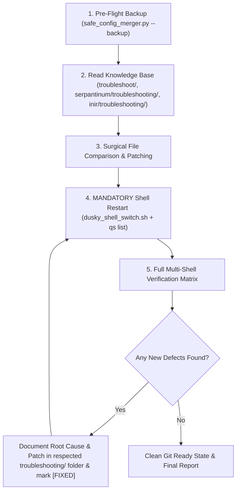

# Universal Prompts for AI Agents (Git Collaboration & Turnkey Setup)

This document contains copy-pasteable prompts designed for users (both collaborators and Ubaid) to give their autonomous AI coding assistants (Claude, Gemini, Cursor, ChatGPT, etc.) when setting up or synchronizing the Dusky Multi-Shell ecosystem.

---

## 📋 PROMPT 1: For Collaborators / Other Users (e.g., adior on Fresh or Existing Install)

Copy and paste the exact block below to your AI assistant:

```markdown
You are an autonomous AI coding assistant. I have cloned/pulled the Dusky Multi-Shell repository at:
`/home/ubaid/Public/dusky_shell_porting_guide/` (or your local clone path).

Your mission is to inspect my current system configuration, compare it against Ubaid's latest multi-shell knowledge base, apply all missing fixes/patches, test every shell, and ensure my system has the exact production-grade setup with ZERO broken features.

Follow these strict rules:
1. READ THE GUIDES FIRST:
   - Primary Playbook: `00_AI_AGENT_AUTONOMOUS_INSTALLER_GUIDE.md`
   - Master Defect Registry: `troubleshoot/00_MASTER_ISSUE_TRACKER.md`
   - Global System Issues: `troubleshoot/01_GLOBAL_AND_SYSTEM_ISSUES.md`
   - Serpantinum Troubleshooting: `serpantinum/troubleshooting/01_SERPANTINUM_ISSUES_AND_FIXES.md`
   - iNiR Troubleshooting: `inir/troubleshooting/01_INIR_ISSUES_AND_FIXES.md`

2. CARDINAL SAFETY & BACKUP:
   - Before modifying any user files, run `python3 <guide_path>/bundle/scripts/safe_config_merger.py --backup`.
   - Never overwrite `~/.config/hypr/` configs or `~/.config/matugen/config.toml`! Safely merge required snippets non-destructively.

3. INSPECT & APPLY ALL VERIFIED FIXES:
   - Serpantinum Clipboard (`S-01`): Verify `~/.config/quickshell/clipboard/Clipboard.qml`. Ensure image cards open to full ~250px previews preserving aspect ratio by default, text stays collapsed at 52px, and `onItemExpandedChanged` does NOT hijack `currentIndex` or scroll position.
   - Wallpaper Matugen Fix (`S-02`): Ensure `~/.config/serpantinum/settings.json` has `"wallpaper"` as a string path, not an object.
   - Laptop Sleep / Lid Quits Quickshell (`G-01` / `S-06`): Ensure lid-close is decoupled to `loginctl lock-session`, lid-open has `--ensure-running`, and `serpantinumd` has a persistent supervision loop.
   - Missing Matugen Templates (`G-03`): Ensure `current-wallpaper.txt` and `shell-switcher.css` are deployed.
   - Upstream Updater Neutralization (`S-07`): Ensure `Updater.qml` has `updateAvailable: false`, update timers disabled, `updater.py` network requests neutered, and `AboutTab.qml` update button replaced with `"Managed by Dusky Multi-Shell"` to prevent catastrophic overwrite by `install.sh`.
   - Upstream 2.3.1 Optimizations (`S-08`): Ensure `completed` guard in `GlassFill.qml`, deferred `glassBackdropItem` binding in `BarModule.qml`, edge handoff timer in `Floating.qml`, dynamic `GlassFillets` in `SideMusicPopout.qml`, and 16-beam Bluetooth shader in `NetworkPopup.qml`.
   - iNiR Silent Launcher Exit (`I-01`): Ensure `apply_niri_app_environment` in `scripts/inir` ends with `return 0`.
   - Material Symbols Fonts (`I-02`): Ensure TTF fonts are in `~/.local/share/fonts/MaterialSymbols/`.
   - iNiR Toplevel Lifecycle Crash (`I-03`): Ensure live-toplevel filter in `CompositorService.qml`.

4. MANDATORY QUICKSHELL RESTART RULE:
   - Quickshell caches QML in memory. Any edits made on disk DO NOT live-reload!
   - You MUST restart the active shell via `~/user_scripts/hypr/dusky_shell_switch.sh <shell>` and verify the new PID with `qs list --all` before verifying any fix!

5. TEST & VERIFY LIVE:
   - Test switching between: `dusky`, `serpantinum`, `iris`, `material`, `waffle`.
   - Test all smart dispatchers: launcher (`ALT+SPACE`), control center (`SUPER+SPACE`), clipboard (`SUPER+V`), lock (`SUPER+M`), sidebar (`SUPER+ESC`).
   - In Serpantinum clipboard: copy a screenshot, verify it opens to full ~250px preview, test Up/Down arrow navigation and mouse wheel scrolling (must not get trapped in an infinite loop).

6. RECIPROCAL DOCUMENTATION:
   - If you encounter or fix ANY new issue or edge case on my machine, you MUST document its root cause, exact patch, and test commands in that shell's `troubleshooting/` folder, and register it in `troubleshoot/00_MASTER_ISSUE_TRACKER.md` with status `[FIXED]`.
   - When finished, present a clean report and instruct me to share it with Ubaid!
```

---

## 📋 PROMPT 2: For Ubaid (When Pulling Collaborator Changes via `git pull`)

Copy and paste the exact block below to your AI assistant:

```markdown
I have just run `git pull` on the multi-shell repository at `/home/ubaid/Public/dusky_shell_porting_guide/`.
Collaborators or other users have updated the troubleshooting knowledge base with new fixes and findings.

Your mission:
1. REVIEW GIT LOG & NEW DEFECTS:
   - Run `git log -n 5 --stat` to inspect recently pulled changes.
   - Read `troubleshoot/00_MASTER_ISSUE_TRACKER.md`, `serpantinum/troubleshooting/00_SERPANTINUM_ISSUE_TRACKER.md`, and `inir/troubleshooting/00_INIR_ISSUE_TRACKER.md` to see what new issues were documented or resolved.

2. AUDIT LOCAL CONFIGS AGAINST NEW FIXES:
   - Compare my local files (`~/.config/quickshell/`, `~/.config/hypr/`, `~/user_scripts/hypr/`) against the newly pulled patches in `troubleshoot/`, `serpantinum/troubleshooting/`, and `inir/troubleshooting/`.
   - If any fix is missing from my live configuration, apply it surgically without overwriting my personal custom settings.

3. RESTART & TEST:
   - Remember: Quickshell NEVER live-reloads QML files. If any QML or script was updated, restart the running shell via `~/user_scripts/hypr/dusky_shell_switch.sh <shell_name>`.
   - Run the regression testing matrix in the respective shell's `00_..._ISSUE_TRACKER.md`.
   - Verify that all shells (`dusky`, `serpantinum`, `iris`, `material`, `waffle`) and all smart dispatchers work with zero warnings or crashes.

4. STATUS SUMMARY:
   - Give me a concise summary of what was pulled, what local files were updated, and confirm that all live tests pass.
```

---

## 🛠️ Step-by-Step AI Execution Protocol

Any AI agent running either prompt must adhere to this five-stage execution lifecycle:



### Stage 1: Pre-Flight Safety
Always execute:
```bash
python3 /home/ubaid/Public/dusky_shell_porting_guide/bundle/scripts/safe_config_merger.py --backup
```
Verify the backup folder in `~/.config/dusky_multishell_backups/` before touching any code.

### Stage 2: Audit & Comparison
Examine:
- `~/.config/quickshell/clipboard/Clipboard.qml`
- `~/.config/serpantinum/settings.json`
- `~/.config/quickshell/inir/scripts/inir`
- `~/.config/quickshell/inir/services/CompositorService.qml`
- `~/user_scripts/hypr/dusky_shell_switch.sh`
- `~/.config/hypr/edit_here/source/keybinds.lua`

### Stage 3: Mandatory Restart
Never attempt to test QML changes while an old Quickshell process is alive. Always restart:
```bash
~/user_scripts/hypr/dusky_shell_switch.sh serpantinum
# Check active PID:
qs list --all
```

### Stage 4: Testing Matrix
Run live dispatchers:
```bash
~/user_scripts/hypr/smart_clipboard.sh
~/user_scripts/hypr/smart_launcher.sh
~/user_scripts/hypr/smart_control_center.sh
```

### Stage 5: Reciprocal Documentation
If you find a new bug or quirk, add it to:
- `serpantinum/troubleshooting/` (for Serpantinum bugs)
- `inir/troubleshooting/` (for iNiR bugs)
- `troubleshoot/` (for global/Hyprland bugs)
Commit cleanly so all users benefit.
