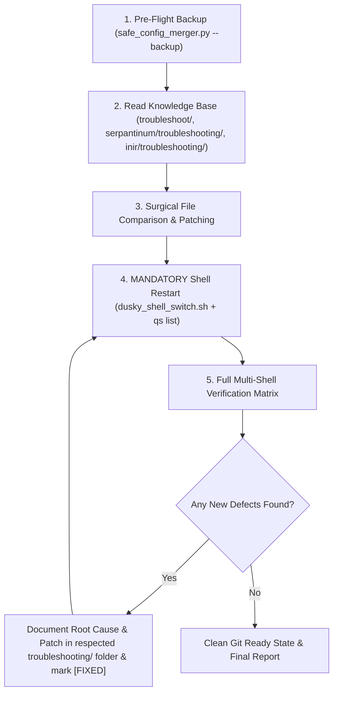

# Universal Prompts for AI Agents (Git Collaboration & Turnkey Setup)

This document contains copy-pasteable prompts designed for users (both collaborators and Ubaid) to give their autonomous AI coding assistants (Claude, Gemini, Cursor, ChatGPT, etc.) when setting up or synchronizing the Dusky Multi-Shell ecosystem.

---

## 📋 PROMPT 1: Universal All-Rounder Prompt (For Collaborators, New Users & Existing Sync)

> **Instructions for User:** Copy and paste the block below directly into your AI coding assistant (Claude, Gemini, Cursor, ChatGPT, etc.). This single prompt automatically detects whether you need a **brand-new installation** or a **synchronization/update of existing files**, applies all verified bugfixes, neutralizes dangerous updater traps, and verifies the entire system live.

```markdown
You are an autonomous AI coding assistant. I have cloned/pulled the Dusky Multi-Shell repository at:
`<path_to_repo>` (or your local workspace directory).

Your mission is to inspect my system, bring my desktop shell setup completely up to date with this knowledge base, fix all known issues, and leave my machine in a 100% stable, production-grade state.

---

### STEP 1: DETECT ENVIRONMENT (NEW INSTALL VS. EXISTING USER)
First, determine what state my machine is in:
- Check if `~/.config/quickshell/` exists and whether `~/user_scripts/hypr/dusky_shell_switch.sh` is present.
- **IF NEW USER / FRESH DEFAULT DUSKY (Multi-Shell not yet set up):**
  1. Follow `00_AI_AGENT_AUTONOMOUS_INSTALLER_GUIDE.md` from start to finish.
  2. Backup user configs with `python3 <repo>/bundle/scripts/safe_config_merger.py --backup`.
  3. Deploy the bundled scripts to `~/user_scripts/hypr/` and ensure executable permissions (`chmod +x`).
  4. Deploy `~/.local/bin/inir` and `~/.local/bin/serpantinumd`.
  5. Deploy required TTF fonts to `~/.local/share/fonts/MaterialSymbols/` and refresh with `fc-cache -f`.
  6. Deploy Matugen templates (`current-wallpaper.txt`, `shell-switcher.css`) into `~/.config/matugen/templates/`.
  7. Non-destructively merge Hyprland keybinds, window rules, and Matugen config using `safe_config_merger.py`.
- **IF EXISTING USER (Updating / Synchronizing after git pull):**
  1. Backup user configs with `python3 <repo>/bundle/scripts/safe_config_merger.py --backup`.
  2. Audit all local files against the guides and apply all missing fixes detailed below.

---

### STEP 2: MANDATORY KNOWLEDGE BASE READING
Before touching any code or configs, you MUST read:
1. `00_AI_AGENT_AUTONOMOUS_INSTALLER_GUIDE.md` (Master architecture and setup playbook)
2. `troubleshoot/00_MASTER_ISSUE_TRACKER.md` (Master registry of all tracked defects: G-xx, S-xx, I-xx)
3. `troubleshoot/01_GLOBAL_AND_SYSTEM_ISSUES.md` (Systemwide issues: sleep crash G-01, keybind collision G-02, templates G-03, wallpaper sync G-04, workspace focus G-06, ghost processes G-07)
4. `serpantinum/troubleshooting/01_SERPANTINUM_ISSUES_AND_FIXES.md` (Serpantinum issues: clipboard preview S-01, scroll loop S-01, Matugen string S-02, entry casing S-03, Escape dismiss S-04, null screen S-05, sleep watchdog S-06, updater trap S-07, 2.3.1 merge S-08)
5. `inir/troubleshooting/01_INIR_ISSUES_AND_FIXES.md` (iNiR issues: launcher return code I-01, Material glyphs I-02, toplevel wayland segfault I-03, lock button I-04, theme lockdown I-05)

---

### STEP 3: SURGICALLY APPLY ALL VERIFIED FIXES
Compare my local files against the troubleshooting guides and ensure EVERY fix is present:
- **Serpantinum Clipboard (`S-01`)**: In `~/.config/quickshell/clipboard/Clipboard.qml`:
  - Images MUST default to expanded ~250px previews preserving aspect ratio (`model.type === "image"`).
  - Text items MUST default to collapsed (52px).
  - `onItemExpandedChanged` must NEVER steal list focus or hijack `clipList.currentIndex` (prevents infinite scroll loop and allows smooth arrow key navigation).
  - Uninstantiated image height in `getItemBounds(idx)` must be `s(250)`.
- **Settings & Matugen (`S-02`)**: In `~/.config/serpantinum/settings.json`, `"wallpaper"` must be a string path (not an object), preventing `TypeError: Property 'trim' is not a function`.
- **Sleep Watchdog (`G-01` / `S-06`)**: Decouple lid-close to `loginctl lock-session`; add `--ensure-running` to lid-open in Hyprland; ensure `serpantinumd` has a persistent supervision loop so the shell never dies on sleep/wake.
- **Upstream Updater Neutralization (`S-07`)**:
  - In `~/.config/quickshell/singletons/system/Updater.qml`: set `updateAvailable: false`, neuter update functions, disable periodic timers.
  - In `~/.config/quickshell/scripts/updater.py`: return `has_update: false` and strip network calls.
  - In `~/.config/quickshell/guide/AboutTab.qml`: lock `updateTransitionProgress: 0.0`, hide update panel, replace "Update" button with `"Managed by Dusky Multi-Shell"` (prevents catastrophic wipeout by upstream `install.sh`).
- **Upstream 2.3.1 Performance Fixes (`S-08`)**:
  - In `GlassFill.qml`: add `completed` guard to prevent Qt binding loop warnings.
  - In `BarModule.qml`: defer `glassBackdropItem` binding to `Component.onCompleted`.
  - In `Floating.qml`: add 400ms edge handoff timer to prevent sidebar unmap jitter.
  - In `NetworkPopup.qml` & `node_beams_clipped.frag`: 16-beam Bluetooth capacity compiled via `qsb`.
  - In `SideMusicPopout.qml`: clean `GlassFillets` + `flatCorners`.
- **iNiR Launcher & Fonts (`I-01`, `I-02`, `I-03`)**:
  - In `scripts/inir`: `apply_niri_app_environment` must end with `return 0`.
  - In `~/.local/share/fonts/MaterialSymbols/`: TTF fonts must be installed.
  - In `CompositorService.qml`: filter toplevels against live wayland surfaces to prevent segfault 11.

---

### STEP 4: MANDATORY QUICKSHELL RESTART
Quickshell compiles and caches QML in memory. File edits on disk DO NOT live-reload!
Whenever any QML or script is updated, you MUST restart the shell via:
`~/user_scripts/hypr/dusky_shell_switch.sh <shell_name>`
and verify exactly ONE process is running using: `qs list --all` and `ps aux | grep quickshell`.

---

### STEP 5: LIVE REGRESSION TESTING
Verify all components live:
1. Switch between shells: `dusky`, `serpantinum`, `iris`, `material`, `waffle`.
2. Test keybindings: App Launcher (`ALT+SPACE`), Control Center (`SUPER+SPACE`), Clipboard (`SUPER+V`), Lock Screen (`SUPER+M`), Sidebar (`SUPER+ESC`).
3. In Serpantinum Clipboard (`SUPER+V`):
   - Take a screenshot (`grim /tmp/test.png && wl-copy -t image/png < /tmp/test.png`).
   - Open clipboard: the screenshot must appear expanded with a large ~250px preview.
   - Text clips must remain collapsed.
   - Scroll up/down with mouse wheel and navigate with Up/Down arrow keys; verify smooth scrolling across all items with zero loops.
4. Open Serpantinum Guide -> About tab: verify version displays `2.3.1`, update badge says `"Managed by Dusky Multi-Shell"`, and no update notifications appear.

---

### STEP 6: RECIPROCAL DOCUMENTATION
If you discover or fix ANY new bug or edge case on my machine:
1. Document the root cause, patch, and verification command in that shell's `troubleshooting/` folder (or `troubleshoot/` for global issues).
2. Register the issue with status `[FIXED]` in that shell's `00_..._ISSUE_TRACKER.md` and in `troubleshoot/00_MASTER_ISSUE_TRACKER.md`.
3. Give me a clear summary of what was installed, patched, and verified, and tell me to share my findings with Ubaid!
```

---

## 📋 PROMPT 2: For Ubaid (When Pulling Collaborator Changes via `git pull`)

Copy and paste the exact block below to your AI assistant:

```markdown
I have just run `git pull` on the multi-shell repository at `/home/ubaid/Public/dusky_shell_porting_guide/`.
Collaborators or other users have updated the troubleshooting knowledge base with new fixes and findings.

Your mission:
1. REVIEW GIT LOG & NEW DEFECTS:
   - Run `git log -n 5 --stat` to inspect recently pulled changes.
   - Read `troubleshoot/00_MASTER_ISSUE_TRACKER.md`, `serpantinum/troubleshooting/00_SERPANTINUM_ISSUE_TRACKER.md`, and `inir/troubleshooting/00_INIR_ISSUE_TRACKER.md` to see what new issues were documented or resolved.

2. AUDIT LOCAL CONFIGS AGAINST NEW FIXES:
   - Compare my local files (`~/.config/quickshell/`, `~/.config/hypr/`, `~/user_scripts/hypr/`) against the newly pulled patches in `troubleshoot/`, `serpantinum/troubleshooting/`, and `inir/troubleshooting/`.
   - If any fix is missing from my live configuration, apply it surgically without overwriting my personal custom settings.

3. RESTART & TEST:
   - Remember: Quickshell NEVER live-reloads QML files. If any QML or script was updated, restart the running shell via `~/user_scripts/hypr/dusky_shell_switch.sh <shell_name>`.
   - Run the regression testing matrix in the respective shell's `00_..._ISSUE_TRACKER.md`.
   - Verify that all shells (`dusky`, `serpantinum`, `iris`, `material`, `waffle`) and all smart dispatchers work with zero warnings or crashes.

4. STATUS SUMMARY:
   - Give me a concise summary of what was pulled, what local files were updated, and confirm that all live tests pass.
```

---

## 🛠️ Step-by-Step AI Execution Protocol

Any AI agent running either prompt must adhere to this five-stage execution lifecycle:



### Stage 1: Pre-Flight Safety
Always execute:
```bash
python3 /home/ubaid/Public/dusky_shell_porting_guide/bundle/scripts/safe_config_merger.py --backup
```
Verify the backup folder in `~/.config/dusky_multishell_backups/` before touching any code.

### Stage 2: Audit & Comparison
Examine:
- `~/.config/quickshell/clipboard/Clipboard.qml`
- `~/.config/serpantinum/settings.json`
- `~/.config/quickshell/inir/scripts/inir`
- `~/.config/quickshell/inir/services/CompositorService.qml`
- `~/user_scripts/hypr/dusky_shell_switch.sh`
- `~/.config/hypr/edit_here/source/keybinds.lua`

### Stage 3: Mandatory Restart
Never attempt to test QML changes while an old Quickshell process is alive. Always restart:
```bash
~/user_scripts/hypr/dusky_shell_switch.sh serpantinum
# Check active PID:
qs list --all
```

### Stage 4: Testing Matrix
Run live dispatchers:
```bash
~/user_scripts/hypr/smart_clipboard.sh
~/user_scripts/hypr/smart_launcher.sh
~/user_scripts/hypr/smart_control_center.sh
```

### Stage 5: Reciprocal Documentation
If you find a new bug or quirk, add it to:
- `serpantinum/troubleshooting/` (for Serpantinum bugs)
- `inir/troubleshooting/` (for iNiR bugs)
- `troubleshoot/` (for global/Hyprland bugs)
Commit cleanly so all users benefit.
