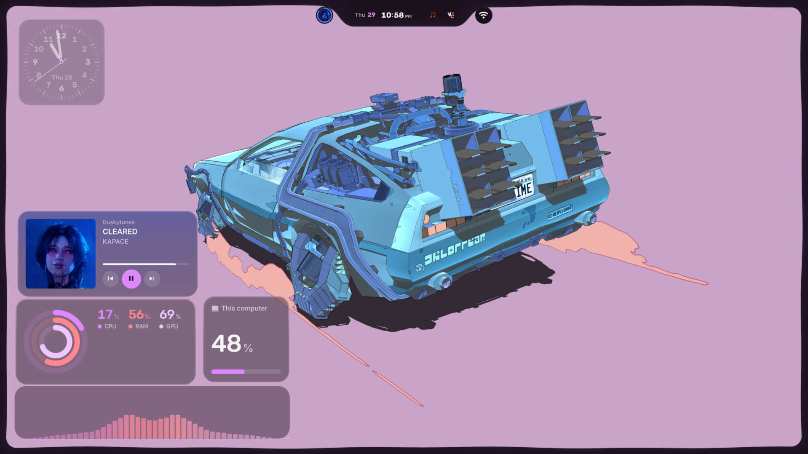
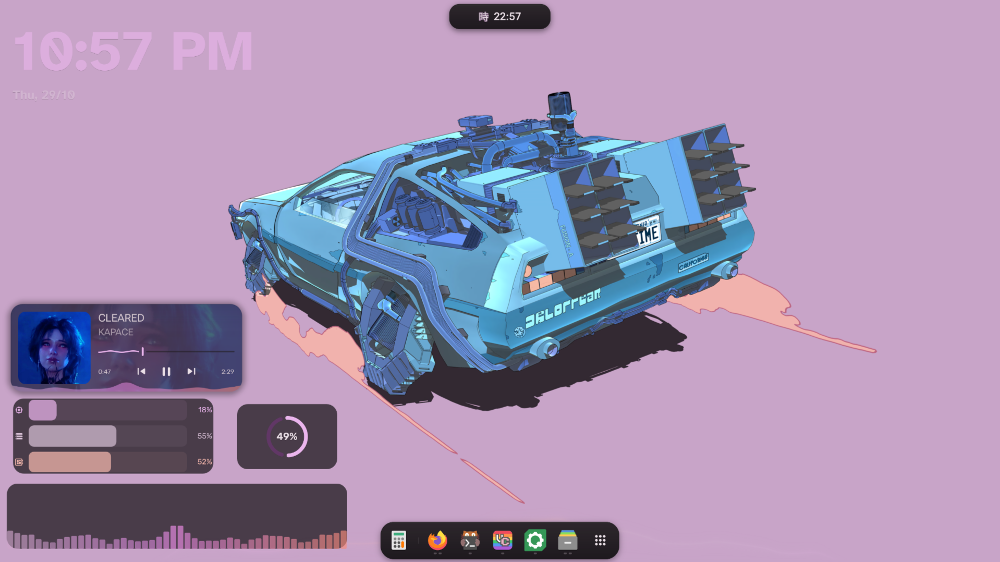
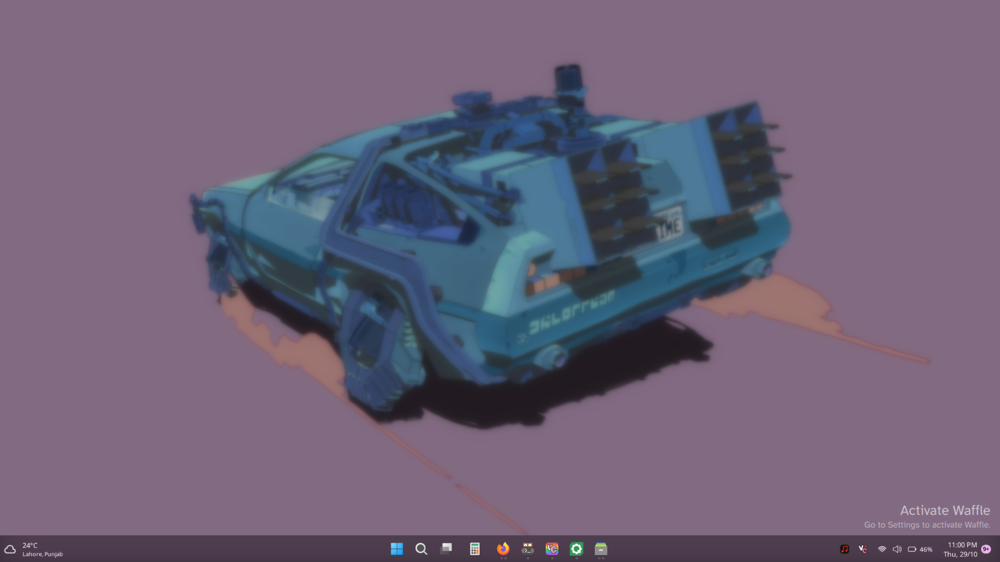

# iNiR Prerequisites & Dependencies on Dusky Linux

This document details all required dependencies, packages, fonts, Qt6 modules, system services, state files, and directory layouts necessary for iNiR (`iris`, `ii`, and `waffle`) to function flawlessly on Dusky Linux.

---

## 1. Visual Subshell Architecture

iNiR hosts three distinct desktop subshells in one unified codebase:

### 1.1 iRiS Island (`inir-iris`)
Minimalist island-centric experience featuring a dynamic top pill, audio visualizer, interactive dashboard, and clean desktop.


### 1.2 Material ii (`inir-ii`)
Full Android/ChromeOS-inspired Material 3 desktop featuring floating bar, bottom dock, dual side drawers, and desktop widgets.


### 1.3 Waffle (`inir-waffle`)
Modern Windows 11-inspired experience featuring centered taskbar, fluent start menu, action center, and calendar.


---

## 2. Upstream Git Repository & Staging Clone

When setting up iNiR on a fresh Dusky installation, clone the official repository into a staging workspace:

```bash
# Upstream repository URL:
# https://github.com/snowarch/iNiR

STAGING_DIR="/tmp/dusky_shell_staging"
mkdir -p "$STAGING_DIR"
git clone https://github.com/snowarch/iNiR "$STAGING_DIR/inir"
```

> [!CAUTION]
> Always physically copy the payload into `~/.config/quickshell/inir/`. Never leave symlinks pointing to `/tmp/`!

---

## 3. Package Dependencies

### 3.1 Arch Linux Official Repositories (`pacman`)
```bash
sudo pacman -S --needed \
  quickshell \
  playerctl \
  brightnessctl \
  cava \
  jq \
  libnotify \
  wireplumber \
  pipewire \
  socat \
  qt6-imageformats \
  qt6-multimedia-ffmpeg \
  qt6-declarative \
  qt6-svg \
  syntax-highlighting \
  wlsunset \
  grim \
  slurp \
  wl-clipboard
```

### 3.2 AUR Packages (`yay` or `paru`)
```bash
yay -S --needed \
  matugen-bin \
  ttf-roboto-flex \
  ttf-material-symbols-variable \
  otf-font-awesome
```

---

## 4. Directory Layout & File Paths

| Path | Purpose |
| :--- | :--- |
| `~/.config/quickshell/inir/` | Root iNiR codebase (QML files, modules, scripts) |
| `~/.config/inir/config.json` | Active iNiR configuration (subshell family, panels, features) |
| `~/.local/state/quickshell/user/generated/colors.json` | Dynamic Material 3 tokens generated by Matugen |
| `~/.local/state/quickshell/user/generated/wallpaper/path.txt` | Current active wallpaper path for iNiR services |
| `/usr/local/bin/inir` | CLI control tool symlinked to `~/.config/quickshell/inir/scripts/inir` |

---

## 5. Key Subshell Verification Commands

Verify each subshell independently using the CLI:
```bash
# Switch to iRiS Island
inir panelFamily set iris

# Switch to Material ii
inir panelFamily set ii

# Switch to Waffle
inir panelFamily set waffle

# Test Overview / App Launcher
inir overview toggle

# Test Control Panel
inir controlPanel toggle

# Test Clipboard
inir clipboard toggle

# Test Screen Lock
inir lock activate
```
