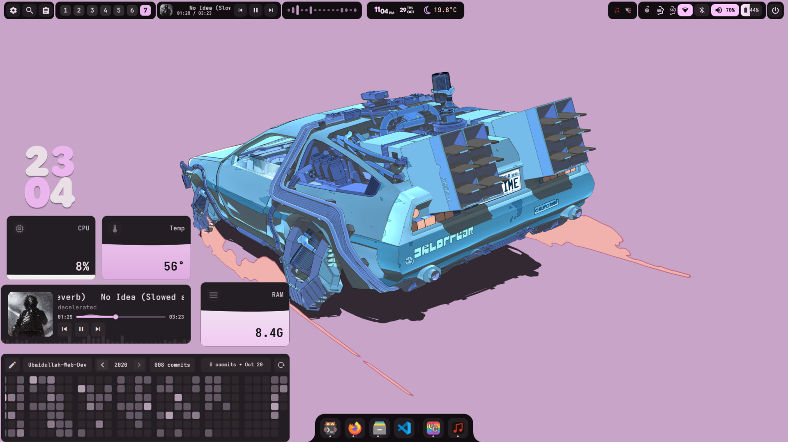

# Serpantinum Prerequisites & Dependencies on Dusky Linux

This document details all required dependencies, packages, fonts, system services, state files, and directory layouts necessary for Serpantinum to function flawlessly on Dusky Linux.

---

## 1. System & Visual Overview

Serpantinum operates as a complete, dynamic desktop environment providing a modular top bar, animated application dock, spotlight launcher, popout drawers, widgets, and dynamic theming.



---

## 2. Upstream Git Repository & Staging Clone

When setting up Serpantinum on a fresh Dusky installation, clone the official repository into a staging workspace:

```bash
# Upstream repository URL:
# https://github.com/ilyamiro/serpantinum.git

STAGING_DIR="/tmp/dusky_shell_staging"
mkdir -p "$STAGING_DIR"
git clone https://github.com/ilyamiro/serpantinum.git "$STAGING_DIR/serpantinum"
```

> [!CAUTION]
> Always physically copy the payload (`quickshell/`, `scripts/`, `assets/`, `bin/`) into `~/.config/quickshell/` and `~/.local/bin/`. Never leave symlinks pointing to `/tmp/`!

---

## 3. Package Dependencies

### 3.1 Arch Linux Official Repositories (`pacman`)
```bash
sudo pacman -S --needed \
  quickshell \
  playerctl \
  brightnessctl \
  cava \
  jq \
  libnotify \
  wireplumber \
  pipewire \
  socat \
  qt6-imageformats \
  qt6-multimedia-ffmpeg \
  syntax-highlighting \
  ttf-font-awesome \
  ttf-jetbrains-mono-nerd
```

### 3.2 AUR Packages (`yay` or `paru`)
```bash
yay -S --needed \
  matugen-bin \
  ttf-material-symbols-variable \
  ttf-roboto-flex
```

---

## 4. Directory Layout & File Paths

Serpantinum resides directly in Quickshell's root directory:

| Path | Purpose |
| :--- | :--- |
| `~/.config/quickshell/` | Root Serpantinum codebase (QML files, assets, modules, scripts) |
| `~/.config/serpantinum/settings.json` | Active user configuration (bar, dock, widgets, styles) |
| `~/.local/state/serpantinum/` | Runtime state (focus daemon, timers, current wallpaper, cached colors) |
| `~/.local/state/serpantinum/current_wallpaper` | Wallpaper path written by Matugen / sync script |
| `~/.local/state/serpantinum/qs_matugen_colors.json` | Dynamic colors generated by Matugen |
| `~/.local/state/serpantinum/qs_colors.json` | Authoritative palette consumed by `theme.reloadColors` |
| `/usr/local/bin/serpantinum` | CLI tool wrapper |
| `/usr/local/bin/serpantinumd` | Background daemon service launcher |

---

## 5. Key Shell Scripts & IPC Targets

Serpantinum communicates with its running instance via Quickshell IPC:
- `~/.config/quickshell/scripts/qs_manager.sh`:
  - `qs_manager.sh toggle system`: Toggles control center side panel (`qs-master`).
  - `qs_manager.sh toggle launcher`: Toggles spotlight launcher (`qs-applauncher`).
  - `qs_manager.sh toggle clipboard`: Toggles spotlight clipboard (`qs-clipboard`).
  - `qs_manager.sh toggle wallpaper`: Launches `/usr/bin/skwd-wall-v2`.
- `~/.config/quickshell/scripts/lock.sh`: Activates lockscreen.
- `~/.config/quickshell/scripts/settings.sh`: Toggles settings manager.
- `~/.config/quickshell/guide/wellbeing/launch_daemon.sh`: Focus and screentime daemon.
