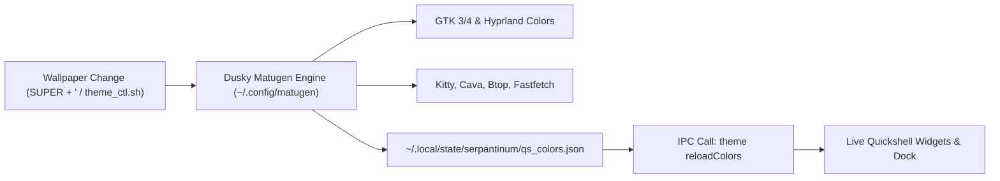

# Dynamic Matugen Theming Integration

Both Dusky Linux and Serpantinum rely on **Matugen** (Material You color generation). Instead of running duplicate background theme daemons, Serpantinum has been hooked directly into your existing Dusky Matugen pipeline.

---

## 1. How the Pipeline Works



---

## 2. Configuration Added to Dusky Matugen

In [`/home/ubaid/.config/matugen/config.toml`](file:///home/ubaid/.config/matugen/config.toml):

```toml
# =============================================================================
# Serpantinum Quickshell (Dynamic Material You Colors)
# =============================================================================
[templates.serpantinum_quickshell]
input_path  = '~/.config/quickshell/assets/matugen/templates/serpantinum_matugen_colors.json.template'
output_path = '~/.local/state/serpantinum/qs_colors.json'
post_hook   = '''
  if pgrep -f "quickshell" >/dev/null 2>&1; then
    quickshell -p "$HOME/.config/quickshell/shell.qml" ipc call theme reloadColors 2>/dev/null || :
  fi
'''
```

---

## 3. What This Achieves

1. **Instant Unified Themes**: Whenever you cycle wallpapers via `theme_ctl.sh next` (`SUPER + '`), your wallpaper changes, Dusky recolors GTK and terminal apps, and Quickshell automatically reloads its palette in milliseconds.
2. **Permanent Standalone Paths**: The template references `~/.config/quickshell/assets/matugen/templates/`, so deleting `/home/ubaid/Public/serpantinum` in the future will not break your theming system.
3. **No Duplicate Daemons**: Serpantinum does not need to poll or re-run Matugen; it passively consumes `qs_colors.json` generated by Dusky.
